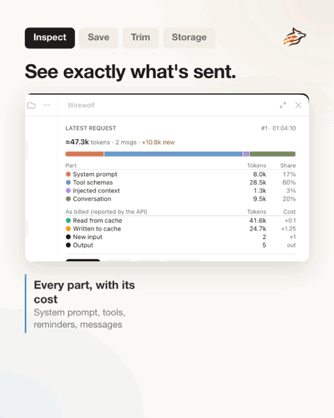
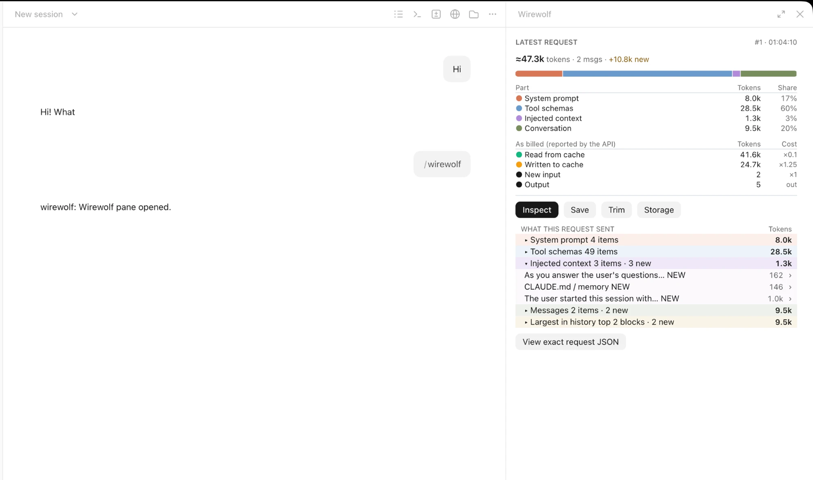
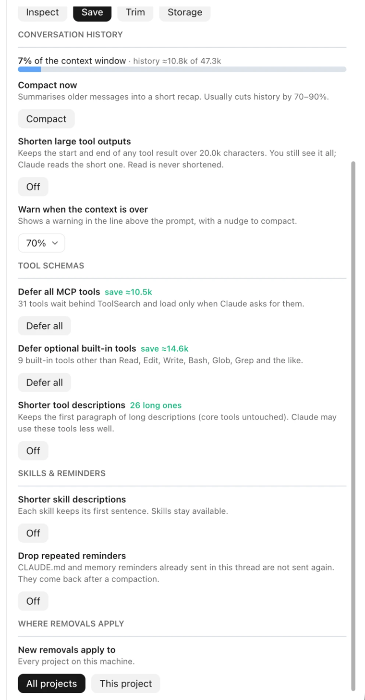
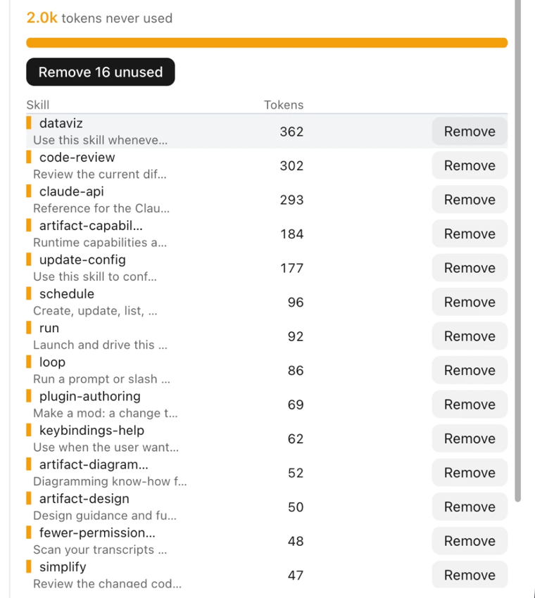
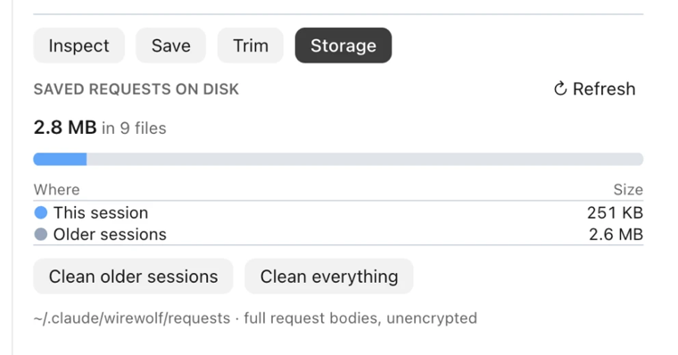

<p align="center">
  
</p>

<h1 align="center">Wirewolf</h1>

<p align="center"><b>See everything Claude Code sends, and stop paying for what it doesn't need.</b></p>

<p align="center">
  
</p>

Every time you send a message, Claude Code re-sends its whole system prompt, every tool schema, the full skill listing and the entire conversation so far. On a long session that is often over 150,000 tokens per request, most of it repeated.

Wirewolf watches the wire. It captures each request as it leaves Claude Code, breaks it into its parts and shows you the exact text. It then gives you the tools to cut what you don't use: unused skills, idle MCP servers, oversized tool outputs, repeated reminders.

**A Claude Code plugin.** It's at its best in the Claude desktop app's **Code** tab, where it docks as a pane beside the chat, and it also works in Claude Code in the terminal and VS Code. It doesn't work in regular Claude chat (claude.ai or the desktop app's Chat tab). It never edits your settings files, and one command puts everything back.

---

## What it does



| Save | Trim | Storage |
|---|---|---|
|  |  |  |

### Inspect: see every request

- **The split:** each request broken into **system prompt**, **tool schemas**, **injected context** (skill listing, CLAUDE.md, reminders), **conversation**, **tool calls & results** and **thinking**, with token counts and a colour bar.
- **The exact text:** click any part to read it, word for word.
- **Largest in history:** the 15 biggest blocks in your conversation, so you can see what's bloating it.
- **Exact request JSON:** the raw payload, byte for byte.
- **As billed:** what the API actually reported, split into tokens read from the prompt cache, written to the cache, new input, and output.
- **Every request kept:** all requests in a session are saved, so you can go back to any of them.

### Save: ways to send less

| Switch | Effect |
|---|---|
| **Compact** | Summarises older messages into a recap. Usually cuts history by 70–90%. |
| **Shorten large tool outputs** | Keeps the start and end of huge command outputs and logs. You see everything; Claude reads the short version. |
| **Defer MCP / built-in tools** | Tool schemas wait behind ToolSearch and load only when Claude needs them. |
| **Shorter tool & skill descriptions** | Keeps the essentials and drops the long explanations. |
| **Drop repeated reminders** | CLAUDE.md and memory aren't re-sent within the same thread. |
| **Context warning** | A heads-up in the line above the prompt when the context passes 50%, 70% or 85%. |
| **This project only** | Removals can apply everywhere, or only in the current project. |

### Trim: remove what you never use

- **Tabs:** **Skills**, **Tools**, **MCP servers** and **Prompt sections**.
- **Every row says** what the item is, what it costs per request, and how often you've actually used it.
- **One press** removes everything you've never used; Restore brings anything back.

### Storage: keep the disk tidy

- **Usage:** see how much space saved requests take.
- **Cleanup:** clean older sessions or everything, with a confirmation step.

---

## Install

From GitHub, at the prompt of a terminal session:

```
/plugin install wirewolf --marketplace csehammad/Wirewolf
```

From a shell:

```bash
claude plugin marketplace add csehammad/Wirewolf
claude plugin install wirewolf@wirewolf
```

In the desktop app, where `/plugin` does not run: click **+** next to the prompt box, then **Plugins** → **Add marketplace** with `csehammad/Wirewolf`, then **Add plugin**.

Then open the pane:

```
/wirewolf
```

---

## Quick start

1. **Send a message**, then run `/wirewolf`. The top of the pane shows how big your last request was and where the tokens went.
2. **Save** → **Defer all MCP tools**. This is usually the biggest safe saving.
3. **Save** → turn on **Drop repeated reminders** and **Shorten large tool outputs** (20k).
4. After a few sessions: **Trim → Skills** → **Remove all never-used**.
5. Run `/clear` to start a fresh, lighter conversation.

See **[Getting started](GETTING-STARTED.md)** for the full guide.

---

## Commands

```
/wirewolf               open the pane
/wirewolf report        text summary of the last request
/wirewolf save          open the ways to send less
/wirewolf skills        open a Trim tab (also: tools, mcp, prompt)
/wirewolf restore       put back everything you removed
/wirewolf reset         restore + switches off + forget usage counts
/wirewolf reset all     reset + delete every saved request
/wirewolf clean [all]   delete saved requests (older sessions, or all)
/wirewolf help          list commands
```

---

## Good to know

- **When changes apply:** removals, deferrals and shorter descriptions take effect after `/clear` or in a new session, so the prompt cache isn't broken mid-thread. Shortened outputs and dropped reminders apply straight away.
- **Read is never shortened.** Claude edits files based on what Read showed it.
- **Dropped reminders come back.** They're re-sent after a compaction or `/clear`, so Claude never loses CLAUDE.md for good.
- **Use counts start at install,** so give it a few sessions before removing "never used" items you rely on.
- **Saved requests are unencrypted.** They live in `~/.claude/wirewolf/requests/` and hold everything Claude saw, including file contents. Clean them from the Storage view.
- **Estimates:** token figures are estimated at about 4 characters per token. The **As billed** table is the API's own count.

---

## How it works

Wirewolf is a Claude Code mod, a hooks module that runs inside Claude Code:

- **Measuring:** it reads each outgoing model request, without changing it.
- **Skills and tools:** it filters the skill listing and the tool list.
- **Deferring:** it moves tools behind ToolSearch.
- **MCP servers:** it holds back the ones you removed.
- **Tool outputs:** it shortens large results before they're stored in the conversation.

There's no proxy and no settings edit, and nothing leaves your machine. Uninstalling puts everything back.

```bash
claude plugin uninstall wirewolf@wirewolf
rm -rf ~/.claude/wirewolf
```

---

Made by **Hammad Ul Haq**: [hammadabbasi.com](https://hammadabbasi.com/) · [hello@hammadabbasi.com](mailto:hello@hammadabbasi.com)

Grew out of [Iris](https://github.com/csehammad/iris-control-plane). Licensed under [Apache 2.0](LICENSE). Independent project, not affiliated with Anthropic.
